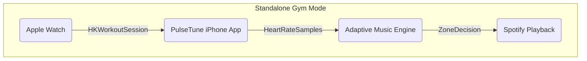
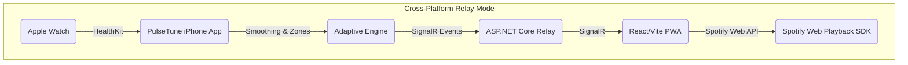

# PulseTune Architecture (Updated for Spotify)

_Last updated: Wednesday, September 30, 2026_

## Overview
PulseTune continuously interprets heart-rate data sourced from the Apple Watch and orchestrates Spotify playback according to configurable workout intensity zones. The system is designed to operate entirely on the user's local devices with optional LAN relay connectivity.

## Core Components
- `HeartRateSource` — abstraction over HealthKit live workouts and mock simulators.
- `HeartRateSmoother` — exponential moving average smoothing.
- `ZoneTransitionEngine` — hysteresis and confirmation timers for zone changes.
- `AdaptiveMusicEngine` — maps confirmed zones to playlist intents and playback policies.
- `MusicPlaybackService` — provider-agnostic interface with Spotify and mock implementations.
- `RelayConnection` — manages SignalR pairing, authentication, and event streaming.

## Data Flow
1. **Capture** — Apple Watch runs a workout session (`HKWorkoutSession` + `HKLiveWorkoutBuilder`).
2. **Transport** — Heart-rate samples arrive on the paired iPhone via HealthKit (and WatchConnectivity fallback when mirroring is unavailable).
3. **Process** — Samples pass through smoothing and zone classification, honoring user-configured thresholds and cooldowns.
4. **Decision** — Adaptive engine selects playlists/tracks according to transition policy (Smooth/Immediate) respecting manual overrides and cooldowns.
5. **Playback** — Spotify playback service issues commands via Spotify App Remote, Web API, or Web Playback SDK depending on the active platform and selected device.
6. **Relay (optional)** — Normalized events stream to the local SignalR relay which broadcasts to web/PWA clients, enabling cross-platform dashboards and control.

## Trust Boundaries
- **Health Data Boundary** — Heart-rate data and workout metadata remain on the iPhone/Watch unless Relay Mode is explicitly enabled. Relay broadcasts sanitized heart-rate events (no personal identifiers).
- **Spotify Auth Boundary** — OAuth tokens are stored using secure storage (Keychain on iOS, secure cookies/local storage for web following Spotify PKCE guidance). Secrets are never transmitted through SignalR.
- **Relay Boundary** — Pairing requires a short-lived numeric code before accepting commands/events. Only authorized devices on the local network may control playback through the relay.

## Platform Responsibilities
- **watchOS App** — Workout UI, heart-rate display, start/pause/resume/end controls.
- **iOS App** — Adaptive engine host, Spotify control, settings, history, relay connection.
- **ASP.NET Core Relay** — Device pairing, SignalR hub, event broadcast, optional Spotify control endpoints (if future requirements demand server-side actions).
- **Web PWA** — Heart-rate dashboard, manual controls, Spotify Web Playback integration, offline-ready install experience.

## Extensibility
- The domain engine is implemented as a Swift Package for reuse between iOS and watchOS apps. Equivalent logic exists in C# and TypeScript for relay and PWA validation.
- Music providers remain abstracted; additional providers could be added by implementing `MusicPlaybackService` without disturbing domain logic.

Refer to `docs/SPOTIFY_SETUP.md` and `docs/APPLE_SETUP.md` for provisioning details.
